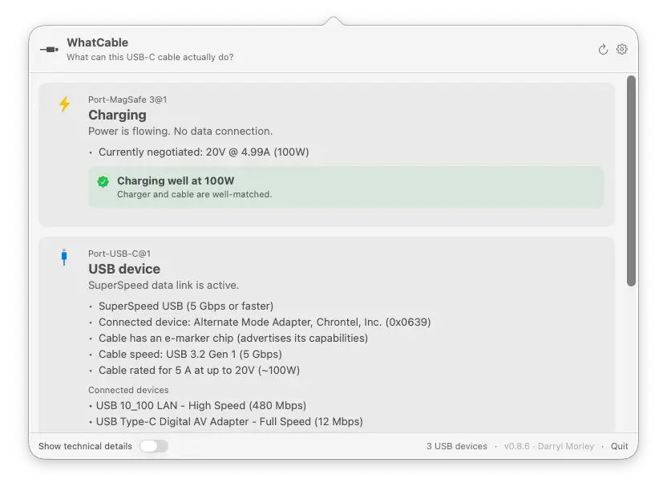

# WhatCable

> **What can this USB-C cable actually do?**

**Website: [whatcable.uk](https://whatcable.uk)** (overview, screenshots, and CLI docs)

A small macOS menu bar app that tells you, in plain English, what each USB-C cable plugged into your Mac can actually do, and **why your Mac might be charging slowly**.

USB-C hides a lot under one connector. Anything from a USB 2.0 charge-only cable to a 240W / 40 Gbps Thunderbolt 4 cable, all looking identical in your drawer. macOS already exposes the relevant info via IOKit; WhatCable surfaces it as a friendly menu bar popover.

Part of a family: [**WhatBattery**](https://www.whatbattery.app) for battery health and charging, [**WhatPort**](https://www.whatport.app) for every port at once.

<a href="https://www.producthunt.com/products/whatcable?embed=true&utm_source=badge-top-post-badge&utm_medium=badge&utm_campaign=badge-whatcable" target="_blank" rel="noopener noreferrer"></a>

[](https://github.com/darrylmorley/whatcable/releases/latest)
[](https://github.com/darrylmorley/whatcable)
[](LICENSE)
[](https://whatcable.uk/pro)



## What it shows

Per port, in plain English:

- **At-a-glance headline:** Thunderbolt / USB4, USB device, Display connected, Charging only, Slow USB / charge-only cable, Nothing connected
- **Charging diagnostic:** when something's plugged in, a banner identifies the bottleneck:
  - *"Cable is limiting charging speed"* (cable rated below the charger)
  - *"Charging at 30W (charger can do up to 96W)"* (Mac is asking for less, e.g. battery near full)
  - *"Charging well at 96W"* (everything matches)
  - *"Battery full, not charging"* (plugged in, battery full, so the Mac isn't drawing power)
- **Mid-session fault warnings:** if a cable develops trouble while it's plugged in (a power overcurrent, or the connection dropping and coming back), a banner appears on the port. It reads the port's own fault counters, so it catches faults that only show up once a cable is under load.
- **Data-speed diagnostic:** a plain-English verdict on what's limiting the link, the Mac port, the cable, or the device. For example *"Cable is limiting data speed"*, *"Device runs at 10 Gbps, this is the fastest it supports, not a cable problem"*, or *"Running slower than expected"* when the link came up degraded. Shown inline, in the CLI, and in JSON.
- **Cable e-marker info:** the cable's actual speed (USB 2.0, 5 / 10 / 20 / 40 / 80 Gbps), current rating (3 A / 5 A up to 60W / 100W / 240W), and the chip's vendor
- **USB-IF certification:** cables that carry a certificate ID (XID) get a "USB-IF certified" line naming the manufacturer. The ID is read off the cable itself and matched against a list of USB-IF certifications bundled with the app, which is where the manufacturer name comes from. Nothing is looked up over the network. A cable advertising an ID that USB-IF doesn't publish gets a neutral "certified but unlisted" line instead. Certification is voluntary and Apple's own cables land there, so it's a fact about the ID, never a verdict on the cable. The raw XID is in the JSON output.
- **Cable trust signals:** an orange card appears when the e-marker reports values that look unusual against the USB-PD spec, like a zero vendor ID, a reserved bit pattern in the speed / current / cable-latency fields, or a VID that isn't in USB-IF's published list. Wording is hedged on purpose: a flag means "this looks unusual," not "this cable is fake."
- **Charger PDO list:** every voltage profile the charger advertises (5V / 9V / 12V / 15V / 20V…) with the currently negotiated profile highlighted in real time
- **Connected device identity:** vendor name and product type, decoded from the PD Discover Identity response
- **Connected devices:** each device is shown inside the thing it's actually plugged into, so a dock chained off a display reads as a chain instead of a flat pile. Hubs are hidden by default, since they're plumbing and make up about half of a typical list. Any device left sitting behind a hidden hub says "via N hubs" so nothing disappears without explanation, and a **Show N hubs** control brings them back for that port. Devices are grouped by USB controller when a port has more than one, and named by their maker where the name alone wouldn't tell two apart. The CLI still prints everything.
- **Thunderbolt fabric:** when a Thunderbolt / USB4 link is active, shows per-lane speed, generation (TB3, TB4, TB5), and the full switch topology for multi-hop connections through docks, plus the active tunnels riding that link so you can see which protocol is going where
- **Cable identification:** if the cable's e-marker fingerprint matches a known cable in the bundled database, the brand and model are shown alongside the raw specs
- **Active transports:** USB 2 / USB 3 / Thunderbolt / DisplayPort
- **Desktop widget:** small, medium, and large WidgetKit widgets showing live cable status on your desktop
- **⌥-click** the menu bar icon (or flip the toggle in Settings) to reveal the underlying IOKit properties for engineers

Click the **gear icon** in the popover header to open Settings, where you can:

- Hide empty ports
- Launch at login
- Run as a regular Dock app instead of a menu bar icon
- Pick the menu bar icon, and show the live charging wattage next to it as either a number or a small fill bar
- Adjust the font size and the window opacity
- Show technical details (the same raw IOKit data that ⌥-click reveals)
- Skip deep USB probing, a compatibility switch for the few KVM switches and hubs that misbehave when WhatCable reads capability info from the devices behind them
- Switch language (English, Armenian, Brazilian Portuguese, Dutch, French, German, Hindi, Italian, Japanese, Korean, Latvian, Norwegian, Persian, Polish, Russian, Simplified Chinese, Spanish, Traditional Chinese, Turkish, Ukrainian, or follow your system default)
- Get notifications when cables are connected or disconnected, and when an app update is available
- Contribute anonymised port and power diagnostics to improve hardware coverage (opt-in, manual)

Right-click the menu bar icon for **Refresh**, a **Keep window open** toggle (handy for screenshots and demos), and **Settings…**. The Pro screens (**Power Monitor**, **Negotiation Diagnostics**, **Display Diagnostics**, **Saved Cables**) and **Licence…** live here too. Below those: **Check for Updates…**, **Contribute Diagnostic Data…**, **About**, **WhatCable on GitHub**, and **Quit**.

## WhatCable Pro

WhatCable is free and open source. If you find it useful, you can support the project by picking up [WhatCable Pro](https://whatcable.uk/pro). Pro is for finding the weak link in a connection and keeping the evidence: live measurements, per-connection diagnostics, and a history of how each cable performs. It unlocks:

- **Cable history:** add a cable, give it a name, and WhatCable keeps a record of how it actually performs over time. It recognises the cable on later connections and builds a timeline: when you last used it, what it negotiated, whether it's been misbehaving. A saved-cables list, an all-time summary per cable, and a verdict right on the port card.
- Live power metering and PD contract inspection
- Power Monitor with a live system power-input graph
- **Negotiation Diagnostics:** the full per-connection breakdown, what the Mac port, cable, and device each support vs what was negotiated, side by side with the weak link highlighted, plus an e-marker vs Thunderbolt-controller cross-check
- **Display Diagnostics:** reads your monitor's live display mode straight from macOS and compares it against what the DisplayPort link is carrying, so a screen stuck below its top resolution or refresh has an explanation. Shows the true resolution even on 5K and 6K displays, confirms full quality when a screen reaches its top mode via compression (DSC), and names any HDMI or DisplayPort adapter in the chain
- Port health counters and cable resistance estimation
- **Terminal dashboard:** a live full-screen view of every port, power, and Thunderbolt for the SSH and tmux crowd. Three screens (Overview, Negotiation, Power), Tab to switch, with a plain cable-health verdict per port. Run `whatcable --dashboard`
- Pin diagrams and liquid detection status
- Pro screens open inside the app, with an optional detach into their own window
- Works even on Macs that don't expose live per-port metering

One-time purchase, works on up to 2 Macs. See [whatcable.uk/pro](https://whatcable.uk/pro) for details.

[](https://whatcable.uk/pro)

## Install

Visit [whatcable.uk](https://whatcable.uk) for an overview and screenshots, or install directly below.

Download the latest `WhatCable.zip` from the [Releases page](https://github.com/darrylmorley/whatcable/releases/latest), unzip, and drag `WhatCable.app` to `/Applications`.

The app is signed with a Developer ID and notarised by Apple, so there are no Gatekeeper warnings.

It's not on the Mac App Store on purpose. Most of what WhatCable reads would in fact survive the App Sandbox: we tested it, and the IOKit registry reads come back identical either way. What the sandbox does block is the SMC access behind Pro's live power metering, and the bundled `whatcable` CLI doesn't fit the store's install model. So it ships signed and notarised outside the store instead.

Requires macOS 14 (Sonoma) or later, Apple Silicon only. This is measured, not assumed: every Intel Mac in the community diagnostic corpus reports its USB-C port-controller services as empty, so the USB-PD state and cable e-marker data WhatCable depends on are not published on those machines through any public IOKit accessor. Thunderbolt fabric data is still present on Intel; it is the port-controller layer that is missing.

> **Note:** The manual install gives you the menu bar app only. The `whatcable` CLI is bundled inside the `.app` and is not on your PATH by default. If you want to use it from the shell, see the [Command-line interface](#command-line-interface) section below for the one-line symlink. Or install via Homebrew, which sets up the CLI automatically.

### Homebrew

```bash
brew install --cask darrylmorley/whatcable/whatcable
```

This installs the menu bar app and symlinks the `whatcable` CLI into your PATH.

### Homebrew, CLI only (no menu bar app)

If you don't want the menu bar app, install just the command-line tool:

```bash
brew install darrylmorley/whatcable/whatcable-cli
```

Same signed and notarised binary, packaged on its own. Useful in terminal-only or scripting environments. Pick one of the two Homebrew installs (both ship the same `whatcable` binary).

Homebrew 6 may warn about untrusted third-party taps on first install. If an existing install starts complaining about an untrusted tap, run `brew trust darrylmorley/whatcable` or see https://docs.brew.sh/Tap-Trust for details.

## Command-line interface

A `whatcable` binary ships alongside the menu bar app, driven by the same diagnostic engine:

```text
$ whatcable

USB-C Port 1
  ✓ Charging well at 96W
  Cable: 5A, 100W, USB4 40 Gbps
  Charger: 5V / 9V / 15V / 20V PDOs

USB-C Port 2
  ! Cable is limiting charging speed
  Cable: 3A, 60W, USB 2.0
  Device: External SSD, USB 10 Gbps
```

Flags:

```bash
whatcable                # human-readable summary of every port
whatcable --json         # structured JSON, pipe into jq
whatcable --watch        # stream updates as cables come and go (Ctrl+C to exit)
whatcable --raw          # include underlying IOKit properties
whatcable --report       # open a pre-filled GitHub issue for the connected cable
whatcable --test-kit     # run diagnostic probes and submit anonymised data
whatcable --no-usb-probe # skip deep USB probing (for KVM switches and hubs that misbehave)
whatcable --desktop      # launch the GUI app in Dock mode
whatcable --popover      # launch the GUI app in menu bar mode
whatcable --version
whatcable --help
```

Pro from the command line:

```bash
whatcable --monitor                        # Pro: live power telemetry (Ctrl+C to exit)
whatcable --monitor-json                   # Pro: live power telemetry as newline-delimited JSON
whatcable --dashboard                      # Pro: full-screen TUI dashboard (Tab cycles screens, q quits)
whatcable --activate XXXX-XXXX-XXXX-XXXX   # validate and store a Pro licence
whatcable --licence                        # show current licence status
whatcable --deactivate                     # remove the stored licence
whatcable --pro                            # show Pro features, open purchase page
```

The CLI prints a one-line Pro hint at the end of plain text output for unlicensed users. Run `whatcable --silence-pro-hints` to hide it (or `--show-pro-hints` to bring it back). Suppressed automatically when output is piped, redirected, or used with `--json`.

If you installed the `.app` manually rather than via Homebrew, the CLI lives at `WhatCable.app/Contents/Helpers/whatcable`. Symlink it into your PATH if you want it on the shell:

```bash
ln -s /Applications/WhatCable.app/Contents/Helpers/whatcable /usr/local/bin/whatcable
```

The Homebrew install does this for you automatically.

## How it works

WhatCable reads four families of IOKit services. No entitlements, no private APIs, no helper daemons:

| Service | What it gives us |
| --- | --- |
| `AppleHPMInterfaceType10/11/12` (M3-era), `AppleHPMInterfaceType18` (MacBook Neo A-series), `AppleTCControllerType10/11` (M1 / M2) | Per-port state: connection, transports, plug orientation, e-marker presence. `Type11` is what M2 MacBook Air uses for its MagSafe 3 port. |
| `IOPortFeaturePowerSource` | Full PDO list from the connected source, with the live "winning" PDO |
| `IOPortTransportComponentCCUSBPDSOP`, `...SOPp`, `...SOPpp` | PD Discover Identity VDOs from the port partner (SOP), the cable's near-end e-marker (SOP'), and the far-end e-marker (SOP'') if present |
| XHCI controller subtree | Each connected USB device is paired to its physical port via the XHCI port node's `UsbIOPort` registry path, falling back to a bus-index derived from the controller's `locationID` upper byte and the port's `hpm` SPMI ancestor on machines that don't expose `UsbIOPort`. |

Cable speed and power decoding follow the USB Power Delivery spec (aligned to USB-PD R3.2 V1.2, March 2026). Vendor names come from a bundled SQLite database (`whatcable.db`) that merges USB-IF's published vendor list, the community `usb.ids` list, and a curated set of cable fingerprints reported by users.

## Build from source

```bash
swift build                  # compile everything
swift run WhatCable          # run the menu bar app (dev mode, no widget or bundle structure)
swift run whatcable-cli      # run the CLI
swift test                   # run the test suite
```

Requires Swift 5.9+ (Xcode 15+). Note: `swift run WhatCable` launches a working dev build but without the widget extension or proper `.app` bundle. For a distributable build, use the build scripts below.

## Build a distributable .app

```bash
./scripts/smoke-test.sh
```

Builds, signs, notarises (if configured), and smoke-tests the app. Produces `dist/WhatCable.app` and `dist/WhatCable.zip`. Safe to run on any branch, any time. Does not touch the Homebrew tap.

**Modes:**

| Configuration | Result |
| --- | --- |
| No `.env` | Ad-hoc signed. Works locally; Gatekeeper warns on other Macs. |
| `.env` with `DEVELOPER_ID` | Developer ID signed + hardened runtime. |
| `.env` with `DEVELOPER_ID` + `NOTARY_PROFILE` | Full notarisation + stapled ticket. Gatekeeper-clean for everyone. |

**Cutting a release:**

```bash
# write release-notes/v<version>.md first, then:
./scripts/release.sh <version>
```

The wrapper does the whole pipeline: bumps the version, runs build-app.sh
(which builds, signs, notarises, smoke-tests, and bumps the local cask),
tags and pushes the commit, creates the GitHub release with the notes
file, verifies the uploaded asset's sha matches the local zip, copies the
notes into the tap, and pushes the tap. Use `--dry-run` first to validate
state. Requires `gh` (auth'd) and the env vars from `.env.example`.

**One-time setup for full notarisation:**

```bash
# 1. Find your signing identity
security find-identity -v -p codesigning

# 2. Store notarytool credentials in the keychain
xcrun notarytool store-credentials "WhatCable-notary" \
    --apple-id "you@example.com" \
    --team-id "ABCDE12345" \
    --password "<app-specific-password>"   # generate at appleid.apple.com

# 3. Create your .env from the template
cp .env.example .env
# ...and fill in DEVELOPER_ID
```

## Caveats

- **Cable e-marker info only appears for cables that carry one.** Most USB-C cables under 60 W are unmarked. Any Thunderbolt / USB4 cable, any 5 A / 100 W+ cable, and most quality data cables will be e-marked.
- **Some cables only reveal their e-marker once something is plugged in at the other end.** The chip in the cable's plug runs off VCONN (a small power rail your Mac feeds into the cable) and only answers when the host issues a "Discover Identity" message. With nothing attached, some Macs read the e-marker straight away, others wait until they see a real partner to negotiate with. If a cable shows up as basic when bare, plug a charger, dock, or device into the far end and check again.
- **WhatCable reads from the Mac's USB-C port, the connected device or charger, and the cable itself.** It cross-checks what each part of the chain reports, so if a cable claims high specs but the negotiated result is lower, you'll see where the mismatch is. That said, software cannot verify what's physically inside the jacket. If a cable's e-marker chip claims 240W / 40 Gbps but the wiring can't deliver, the chip is lying, not WhatCable. The trust-signals card flags a small set of internal-consistency tells (zero VID, reserved bit patterns in the Cable VDO, a VID not in the USB-IF list). These are common in budget cables and don't necessarily mean anything is wrong. They're informational, not a verdict.
- **Desktop front USB-C ports show devices, but no cable detail.** On Apple Silicon desktops (Mac mini, Studio), the front USB-C ports are plain USB behind an internal hub, not full USB-C ports with their own controller like the rear Thunderbolt ports. Anything plugged into them now appears under a **Built-in USB ports** section, but the Mac exposes no cable, power, or PD data for them, so there's no e-marker or charging detail to show. The rear Thunderbolt ports work fully.
- **PD spec coverage:** the decoder is aligned to USB-PD R3.2 V1.2 (March 2026). Earlier 3.0 / 3.1 cables work fine.
- **Vendor name lookup uses a bundled database** (thousands of USB-IF entries plus the community usb.ids list). VIDs assigned after the bundled snapshot will show as "Unregistered / unknown" and trip a trust-signal flag until the database is refreshed.

## Linux port

[@abrauchli](https://github.com/abrauchli) built a Rust port for Linux called [usbeehive](https://github.com/abrauchli/usbeehive). Install it with `cargo install usbeehive`. It reads from the kernel's typec sysfs interface rather than IOKit, so it's an independent implementation rather than a fork. It started life as a `whatcable` crate on crates.io before being renamed to avoid confusion with this repo. He's also working on [usbee](https://github.com/abrauchli/usbee), a GNOME UI for it (early stage, but the basics work).

## The other half of the question

WhatCable can tell you a charger negotiated 60W when your Mac wanted 96W. It cannot tell you what that has been doing to the battery on the other end of the cable, because that is a different part of the Mac and out of scope here.

[**WhatBattery**](https://www.whatbattery.app) covers that side: unrounded battery health, live charge and discharge in watts, per-cell readings from the pack, and what happened to the charge while the Mac was asleep. Same developer, same read-only approach, same Apple Silicon and macOS 14 floor.

[**WhatPort**](https://www.whatport.app) is the port-side companion: protocol, speed, lane status and live power draw for every port on your Mac at once, where WhatCable focuses on the cable in one of them.

## Privacy

WhatCable reads USB-C port state directly from IOKit on your Mac. All of that happens locally. Nothing is sent anywhere automatically.

**Cable reports:** If you use the "Report this cable" button on an e-marked cable, WhatCable builds a pre-filled GitHub issue containing the cable's vendor ID, product ID, and capability flags (VDOs). Your browser opens with that data in the issue form. Nothing is submitted until you click the button in GitHub yourself. Once submitted, the issue is public.

**Update checks:** WhatCable checks the GitHub Releases API for a newer version when it starts, every six hours, and when you open the menu if it hasn't checked in the last 30 minutes. No personal data or hardware info is included in that request.

**Diagnostic data:** Settings has an opt-in **Contribute Diagnostic Data** button. When you press it, WhatCable collects raw IOKit registry properties about your Mac's USB ports, power and connected hardware, a list of the driver classes present, and your macOS version, chip type and Mac model identifier, then submits them to help improve hardware coverage. Your Mac's own identifiers are left out. It only runs when you click it; nothing is collected or sent unless you choose to.

## Contributing

Issues and PRs welcome. The code is small and tries to stay readable.

**Where to start:**

| Module | Role |
| --- | --- |
| [`Sources/WhatCable/`](Sources/WhatCable/) | Main menu bar app UI (SwiftUI popover, settings, notifications) |
| [`Sources/WhatCableCore/`](Sources/WhatCableCore/) | Shared diagnostic logic, PD bit decoding, text formatting |
| [`Sources/WhatCableDarwinBackend/`](Sources/WhatCableDarwinBackend/) | IOKit watchers (port state, PD identity, power sources, USB devices, Thunderbolt fabric) |
| [`Sources/WhatCableAppKit/`](Sources/WhatCableAppKit/) | Plugin registry and extension points (hooks for Pro features, CLI commands, menu items) |
| [`Sources/WhatCablePlugins/`](Sources/WhatCablePlugins/) | Pro features (power metering, licence, cable and display diagnostics, liquid detection) |
| [`Sources/WhatCableWidget/`](Sources/WhatCableWidget/) | WidgetKit extension (small/medium/large desktop widgets) |
| [`Sources/WhatCableCLI/`](Sources/WhatCableCLI/) | CLI binary, shares Core/Backend/Plugins with the app |

### Translations

Read [TRANSLATIONS.md](TRANSLATIONS.md) first: it covers the terminology policy (technical labels stay in English) and which languages have an active maintainer who reviews changes.

WhatCable uses `.lproj/.strings` files for localisation. Each module (`WhatCable` and `WhatCableCore`) has its own set under `Sources/<module>/Resources/<lang>.lproj/Localizable.strings`.

To add a new language:

1. Copy `en.lproj/Localizable.strings` from both modules into a new `<lang>.lproj/` directory
2. Translate the values (leave the keys as-is)
3. Make sure format specifiers (`%@`, `%lld`, `%1$@`, etc.) match the English originals exactly
4. Run `plutil -lint` on your files to check for syntax errors
5. If the language has its own plural rules, copy `en.lproj/Localizable.stringsdict` in the `WhatCable` module and translate the `one`/`few`/`many`/`other` forms
6. Add the language code to `CFBundleLocalizations` in [`scripts/smoke-test.sh`](scripts/smoke-test.sh)

The Settings language picker builds itself from the bundled `.lproj` resources, so a new language appears there automatically once the files are in place.

### Diagnostic data

The single most helpful thing you can do is hit **Contribute Diagnostic Data** in Settings. It runs a short set of probes that read the hardware data macOS already publishes about your Mac's ports, power and connected devices, then submits the results. The whole process takes a few seconds, nothing is sent without your explicit click, and no personal information is included.

More device data means better hardware coverage, fewer edge-case bugs, and more accurate diagnostics for everyone. If you have unusual hardware (docks, hubs, TB5 gear, high-wattage chargers), your report is especially valuable.

Cable reports are also very welcome. If you have an e-marked cable, use the "Report this cable" button in the app (or `whatcable --report` from the CLI) to submit its fingerprint. These reports build the bundled cable database so WhatCable can show brand and model info for known cables. Every report you submit helps other users identify their cables at a glance.

### Research references

Some comments and docs cite files under `research/` (for example `research/displays/display-node-keys.md`). That folder is my private research library, built from raw diagnostic dumps off real machines, and it is not part of this repo. The references stay so each decision names its evidence, even where you cannot open it. Comments may likewise name private notes, tooling and rules, which are not part of this repo either.

## Credits

Built by [Darryl Morley](https://github.com/darrylmorley).

**Contributors:**
- [@rolandgroen](https://github.com/rolandgroen) - option-click technical details, gear menu in popover
- [@0x687931](https://github.com/0x687931) - UI polish, hardware matching, updater hardening, USB-C/MagSafe fix
- [@blech](https://github.com/blech) - USB device matching for hubs, settings view, Cmd+R refresh shortcut
- [@willhsieh](https://github.com/willhsieh) - window/Dock mode
- [@hobostay](https://github.com/hobostay) - SIGTERM handling, charging threshold fix, installer temp file leak fix
- [@JimmFly](https://github.com/JimmFly) - localisation infrastructure, Simplified Chinese translation
- [@IonBazan](https://github.com/IonBazan) - i18n migration to .lproj/.strings, Polish translation, obsolete vendor IDs
- [@bovirus](https://github.com/bovirus) - Italian translation
- [@Vardan933](https://github.com/Vardan933) - Armenian translation
- [@jimmyorz](https://github.com/jimmyorz) - Traditional Chinese translation
- [@dohun0310](https://github.com/dohun0310) - Korean translation
- [@shpokas](https://github.com/shpokas) - Latvian translation
- [@abrauchli](https://github.com/abrauchli) - screenshot fix
- [@durul](https://github.com/durul) - updater security audit
- [@nervous-inhuman](https://github.com/nervous-inhuman) - USB device matching and port state bug reports
- [@hgschmie](https://github.com/hgschmie) - e-marker and Thunderbolt cable documentation that led to e-marker detection
- [@joeshaw](https://github.com/joeshaw) - dual power source bug report, Thunderbolt data samples
- [@jlbyrne-76](https://github.com/jlbyrne-76) - M4 Mac Mini front port e-marker bug report, cable reports
- [@stevetrease](https://github.com/stevetrease) - M3 and M4 ioreg dumps, TB3 data samples
- [@jshier](https://github.com/jshier) - M3 Ultra Thunderbolt data, AppleSmartBattery dumps
- [@NoFr1ends](https://github.com/NoFr1ends) - TB5 hardware confirmation (JHL9580 dock, M5 Pro)
- [@iFindProblems](https://github.com/iFindProblems) - Dock mode bug reports
- [@NaiveTomcat](https://github.com/NaiveTomcat) - Power Monitor regression and MagSafe PD contract bug reports
- [@pandoratactful](https://github.com/pandoratactful) - active Thunderbolt cable e-marker mismatch report
- [@jesserobbins](https://github.com/jesserobbins) - grouping devices by USB controller, per-device serial and USB version in JSON output
- [@VailElla](https://github.com/VailElla) - cable report speed values read from the cable's own bits, CLI output sanitising, test-kit probe limits
- [@offyotto](https://github.com/offyotto) - stale power-contract wattage no longer reported as live
- [@dhruvsheth10](https://github.com/dhruvsheth10) - refresh icon spins while a refresh runs
- [@hinaloe](https://github.com/hinaloe) - charger wattage stuck at 3W with a second device attached, report and diagnostics
- [@asapuntz](https://github.com/asapuntz) - KVM switch and hub compatibility report that led to the deep-probe switch
- [@CronoCX](https://github.com/CronoCX) - desktop built-in USB port grouping report
- [@official-Cromatin](https://github.com/official-Cromatin) - M1 Pro charging contract report, and the detail that found it in the SMC
- [@aguilaair](https://github.com/aguilaair) - Power Monitor icon mismatch report
- [@cannotcollide](https://github.com/cannotcollide) - identifying the Apple Thunderbolt 4 Pro Cable behind a bad database row

**Beta testers:**
- [@jimmyorz](https://github.com/jimmyorz), [@aguilaair](https://github.com/aguilaair), [@cannotcollide](https://github.com/cannotcollide), [@themadturk7](https://github.com/themadturk7), [@Caruso8677](https://github.com/Caruso8677), [@Mostxlnt](https://github.com/Mostxlnt) and [@aldobalducci](https://github.com/aldobalducci), who put four builds through their desks before v1.3.0

**Sponsors:**
- [@1A1zRyan](https://github.com/1A1zRyan)
- [@SpartanDavie](https://github.com/SpartanDavie)
- [@zippykeyop](https://github.com/zippykeyop)

Thanks to everyone who has filed cable reports, bug reports, and IOKit dumps. These contributions directly improve the cable database and help WhatCable handle more hardware correctly.

Inspired by every time someone has asked "*is this cable any good?*".
